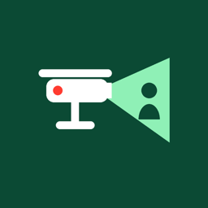
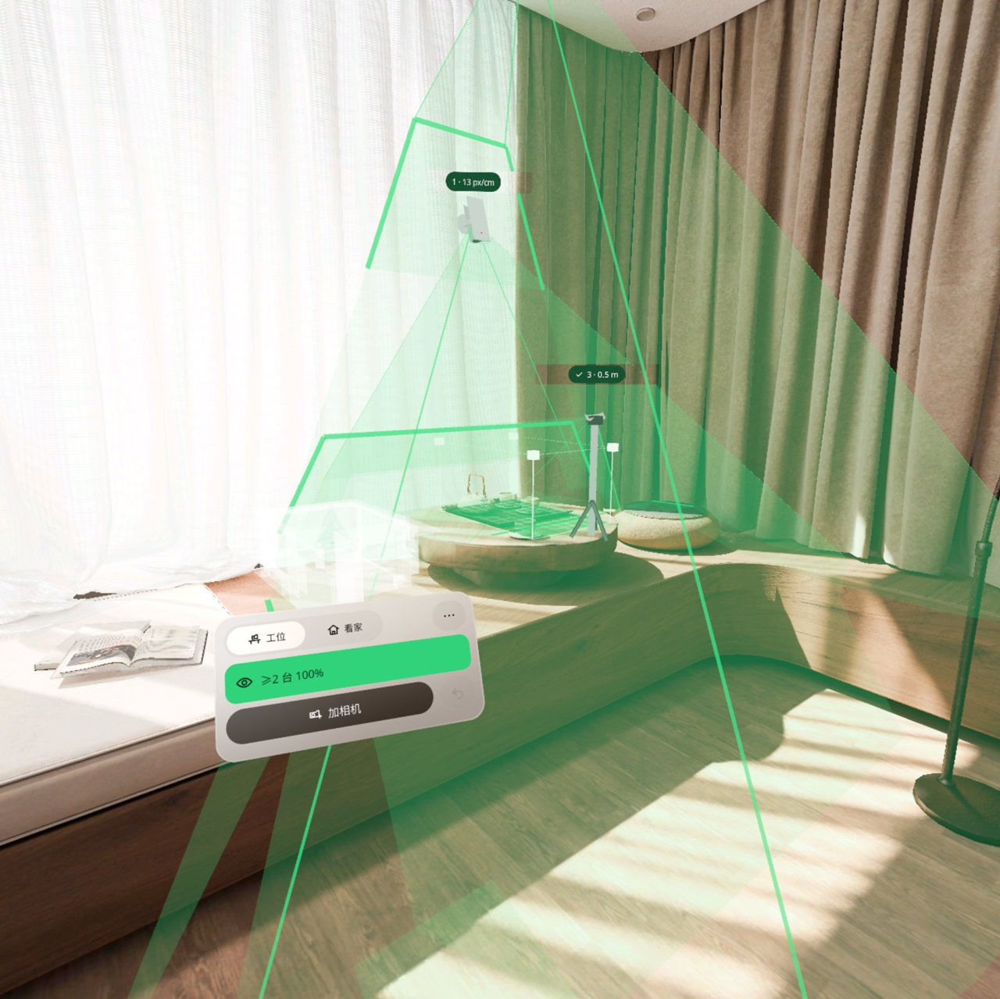
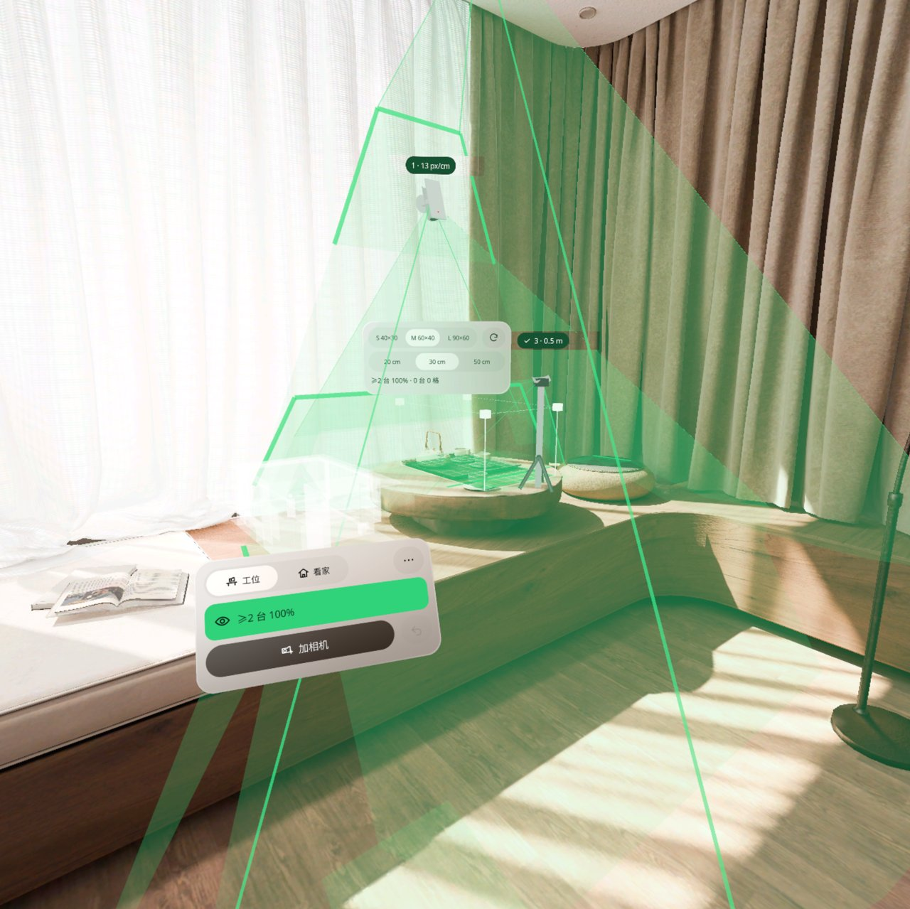
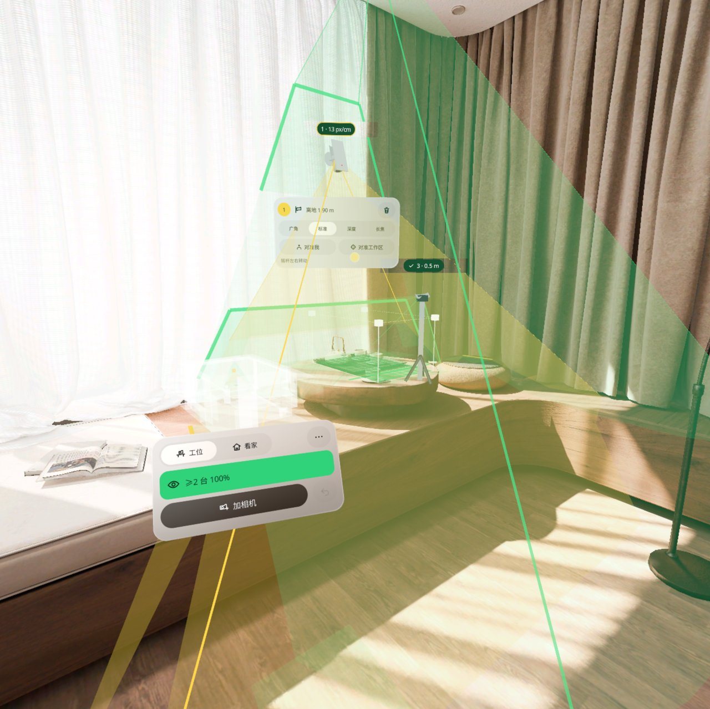
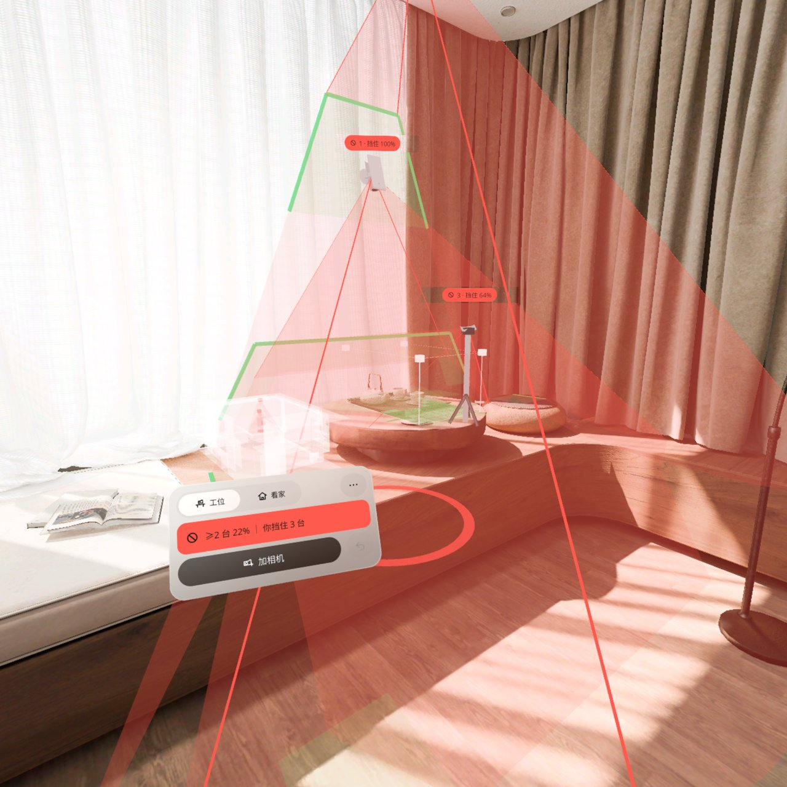
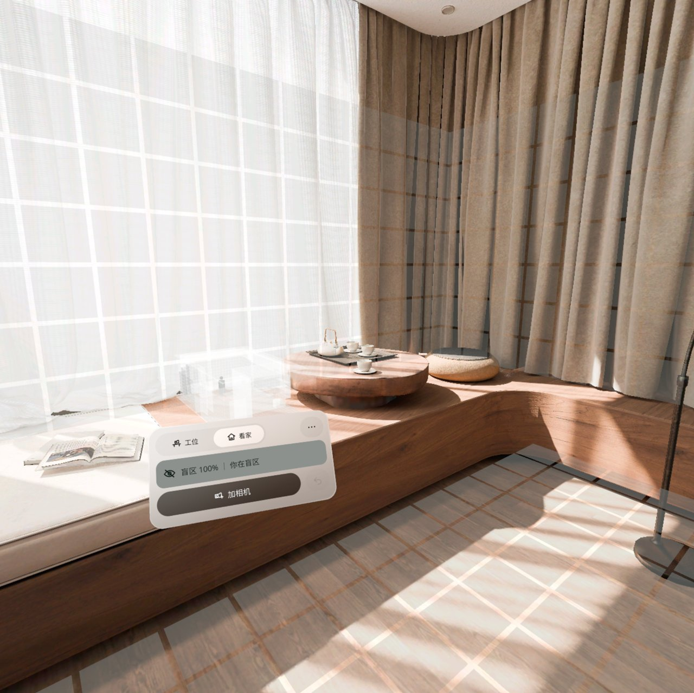
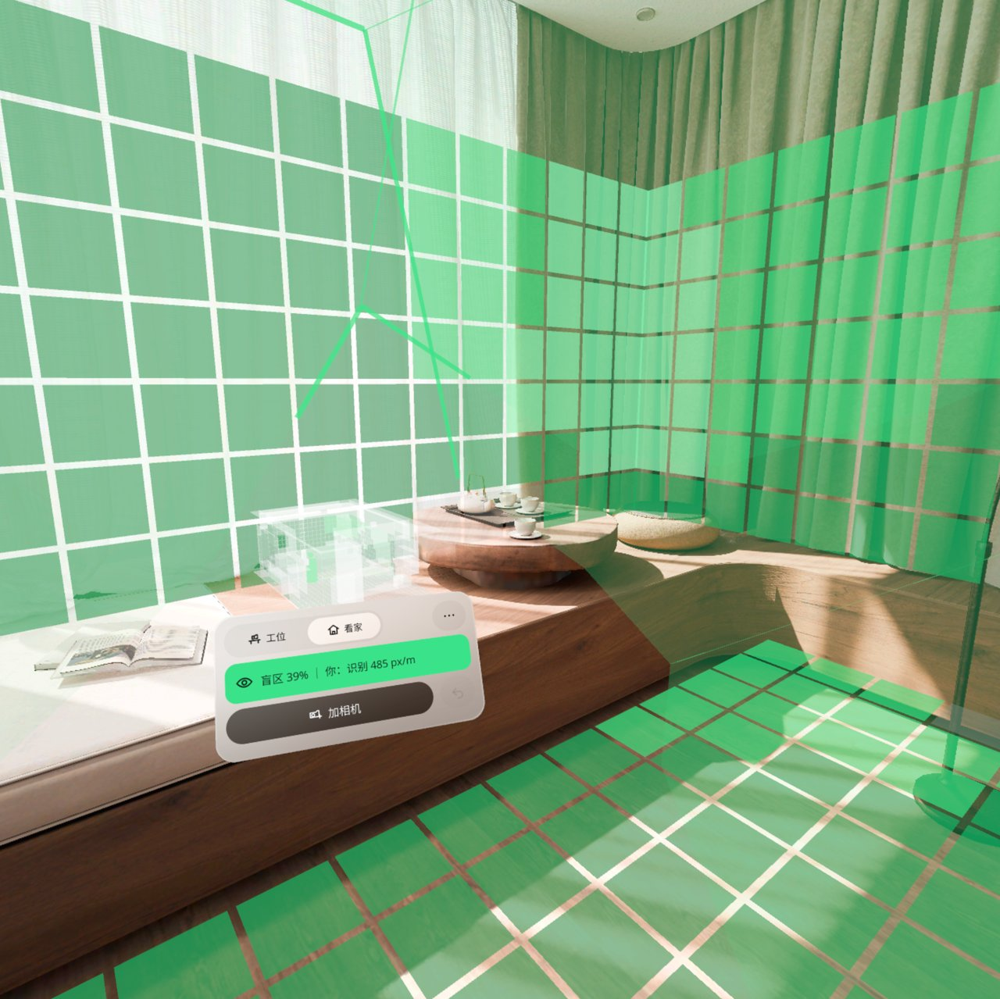
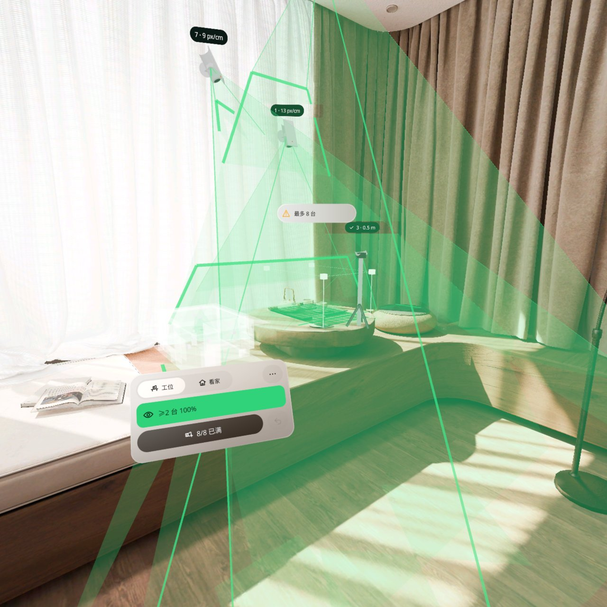
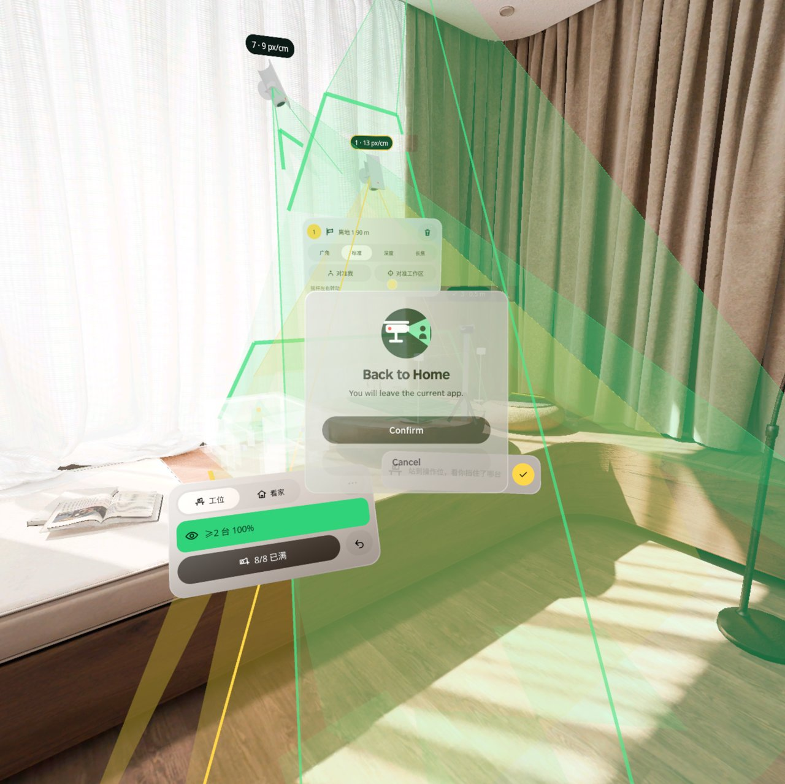

<p align="center"></p>

# Camera Coverage | 监控盲区

**打孔装机之前，先把虚拟摄像头装到你家真墙角、真工位旁：视锥照到哪、哪里是盲区一眼看见；走到门口看自己变没变绿，站到操作位看自己挡住了哪台。**

**Before drilling any holes, mount virtual cameras on your real walls and next to your real workbench: see where each cone reaches and where the blind spots are, walk to the door to see whether you turn green, and stand at the operator spot to see which camera your body blocks.**

PICO OS 6 · PICO Spatial SDK 6.1.9 · Kotlin / SpatialUI · package `io.embodit.camcoverage` · v0.1.0 (pre-release / 预发布)

> **模拟器 QA 通过，真机未验证（Simulator-QA passed; not yet verified on a real headset）。**



> 截图和演示视频来自原生模拟器（PICO Emulator 6.1），由调试广播驱动跳转到各设计状态；**非真实手势录像**。
> Screenshots and the demo video were taken on the native PICO emulator, driven by debug broadcasts that jump to each design state; **not a recording of real hand gestures.**

---

## 中文

### 这是什么

点墙、天花板、桌面或放一个三脚架，就装上一台虚拟摄像头。每台相机打出一个半透明的 3D 视锥，碰到第一块真实平面就停下，照到的地方留下光斑，编号牌上写着清晰度读数（按安防行业的 DORI 分档：探测 / 观察 / 辨认 / 识别，单位 px/m）。镜头可以选广角、标准、深度、长焦，可以一键「对准我」或「对准工作区」，也可以拖动瞄准球或推摇杆调方向。最多 8 台。

两种模式：

- **工位**：在桌上放一个 60×40×30 cm 的工作区（S / M / L 可选），工作区的 5 cm 格子按被几台相机同时看到上色，状态行写「≥2 台 87%」。你站到操作位时，被你身体挡住的相机变红，状态行写「你挡住 1 台」。适合布置机器人采数台的固定机位。
- **看家**：地面和墙面按 DORI 分档上色，灰色是盲区；你脚下有一圈光，走到哪就告诉你那里能不能被拍到、能拍多清楚。

布置会存下来，下次打开自动找回。中英双语，m / ft 可切，全部本机保存，不联网。

### 安装与启动

```bash
adb install -r CameraCoverage-v0.1.0.apk
pico-cli app launch io.embodit.camcoverage
```

APK 在 [Releases](https://github.com/kejing-dev/CameraCoverage/releases) 页面下载（仓库不含 APK）。需要 PICO OS 6 头显或 PICO Emulator 6.1；用到平面识别和空间锚点。APK 约 34 MB。

### 容器与骨架

- **容器**：只有 Full Space · `STAGE_MIXED`（透视），没有 Shared Space 版本。相机要装在真实墙面 / 天花板 / 桌面上，视锥要被真实平面截断，判定要用你真实的头部位置：透视、平面检测、头部位姿、世界锚点只在 Full Space 可用。
- **骨架 D**（同影院规划 Theater Planner / 空间尺 Spatial Ruler）：面板池、Stage 根实体、平面碰撞体、世界锚点、系统拖动换算、懒跟随、摇杆输入。覆盖计算在后台协程；视锥等动态网格排队按帧生成，避免主线程卡住。
- **状态**：设计包 24 个状态（S01–S24），全部可由调试广播直接跳转并截图，结构见 [AGENTS.md](AGENTS.md)。

### 截图

| | |
|---|---|
|  |  |
| 工作区 — 放在桌上，S / M / L、转 90° | 选中相机 — 视锥变黄，相机卡选镜头、对准我 / 工作区 |
|  |  |
| 你挡住了 — 被身体挡住的相机变红，脚下红圈 | 看家 · 空房间 — 还没相机，地面墙面全是盲区 |
|  |  |
| 看家 · 你被看到 — 「你：识别 485 px/m」 | 8 台满了 — 「8/8 已满」 |

启动器图标：



### 已知问题（QA 第 1 轮，不影响使用）

- 模拟器房间把床也报成了桌面类平面，放工作区时床上也描了黄虚线；真房间里床、沙发被识别成桌面时会多几个可选的框。
- 选中相机时，黄色半透明视锥压在相机卡上，卡片整体发黄；瞄准球会挡住「对准工作区」按钮的一角。字读得出、按钮点得到，换个角度就好。
- 8 台相机在空闲模拟器上要将近一分钟才画全：视锥网格改成排队分帧生成，模拟器空闲时每秒只画 1–2 帧；头显上会快很多。
- 模拟器整机重启后找不回上次的布置（走「上次的布置不在这里」）；只重开应用时 8 台都能找回。头显跨重启能否找回要真机验。
- 「空间能力不可用」对话框出来时，相机和视锥也隐藏了（设计只要求控制台禁用）。
- 离 2 米以外时，编号牌和相机卡上的字很小，走近看就清楚。

还没在头显上验过：真手柄摇杆转相机、捏合拖动瞄准球 / 相机 / 工作区的手感、真人站到操作位和走到门口时的判断（模拟器里用注入的头部位置验）、真实房间的平面质量、关机重开后找回、权限弹窗。

---

## English

### What it is

Tap a wall, the ceiling, a desk, or drop a tripod, and a virtual camera is mounted there. Each camera casts a translucent 3D cone that stops at the first real surface, leaves a footprint where it lands, and carries a number tag with its reading (DORI grades from the security industry: Detect / Observe / Recognize / Identify, in px/m). Pick a wide, standard, depth or tele lens, aim it at yourself or at the work area with one tap, or drag the aim ball / push the thumbstick. Up to 8 cameras.

Two modes:

- **Workcell**: place a 60×40×30 cm work area on the desk (S / M / L); its 5 cm cells are coloured by how many cameras see them, and the status line shows the share seen by at least two cameras. Stand at the operator spot and the cameras your body blocks turn red, with a count on the status line. Useful for laying out fixed cameras around a robot data-collection bench.
- **Home**: the floor and walls are coloured by DORI grade, grey is blind; a ring at your feet tells you, wherever you stand, whether you are seen and how sharply.

The layout is saved and found again next time. Chinese and English, m / ft, everything stored on the device, no network.

### Install and launch

```bash
adb install -r CameraCoverage-v0.1.0.apk
pico-cli app launch io.embodit.camcoverage
```

Download the APK from the [Releases](https://github.com/kejing-dev/CameraCoverage/releases) page (the repository itself does not ship an APK). Needs a PICO OS 6 headset or PICO Emulator 6.1; uses plane detection and spatial anchors. The APK is about 34 MB.

### Container and skeleton

- **Container**: Full Space only, `STAGE_MIXED` (passthrough); no Shared Space version. Cameras mount on real walls / ceiling / desks, cones are clipped by real planes and the verdicts use your real head position — passthrough, plane detection, head pose and world anchors are Full Space only.
- **Skeleton D** (same as Theater Planner / Spatial Ruler): panel pool, Stage root, plane colliders, world anchors, system-drag conversion, lazy follow, thumbstick input. Coverage is computed in a background coroutine; cones and other dynamic meshes are queued across frames so the main thread never stalls.
- **States**: 24 designed states (S01–S24), each reachable by a debug broadcast and captured; see [AGENTS.md](AGENTS.md).

### Screenshots

See the table above: work area, selected camera, you block a camera, empty home, you are seen, eight cameras.

### Known issues (QA round 1, none blocking)

- The emulator room reports the bed as a desk-like plane, so it also gets a yellow outline when placing the work area; in a real room a bed or sofa recognised as a desk adds extra choices.
- With a camera selected, its yellow translucent cone overlaps the camera card and tints it yellow, and the aim ball covers a corner of the aim-at-work-area button. Text stays readable and the button still works.
- Eight cameras take almost a minute to draw on an idle emulator, because cone meshes are now built one per frame slot and the idle emulator draws 1–2 frames per second; a headset is far faster.
- After a full emulator reboot the saved layout is not found (the app says the last layout is not here); reopening the app without a reboot restores all 8 cameras. Whether a headset restores across reboots needs a device test.
- When the spatial-features-unavailable dialog shows, cameras and cones are hidden as well (the design only asked to disable the console).
- Beyond about 2 m the number tags and the camera card are small; walk closer to read them.

Not yet verified on a headset: thumbstick aiming with a real controller, the feel of pinch-dragging the aim ball / cameras / work area, real walking to the operator spot or the door (the emulator used injected head positions), plane quality in a real room, restoring after a reboot, permission prompts.

---

## License

Source code © 2026 Embodit. All rights reserved (private repository). Bundled fonts Noto Sans / Noto Sans SC are under the SIL Open Font License, see `third_party/`. DORI thresholds follow IEC EN 62676-4 (public values).
